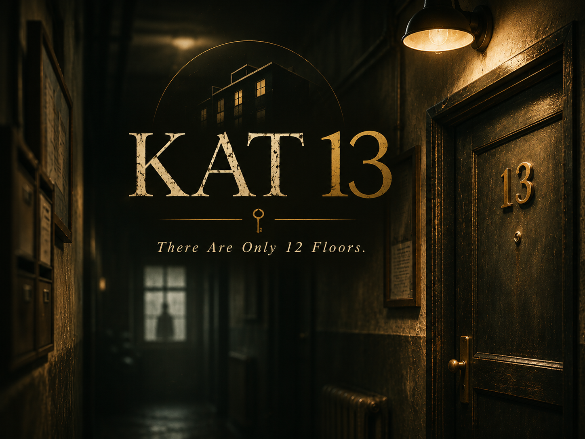

  

# KAT 13

### *There Are Only 12 Floors.*

## About the Game

KAT 13 is an independently developed, story-driven psychological horror and mystery game set in an atmospheric apartment building.

Explore unsettling environments, investigate mysterious evidence, solve interconnected puzzles, and uncover secrets hidden within the building.

The experience emphasizes psychological tension, environmental storytelling, and mystery rather than loud jumpscares.

## Play the Game

**[Play KAT 13 on itch.io](https://simanur.itch.io/kat-13)**

No installation required. Play directly in your browser.

## Key Features

- Six interconnected story chapters
- Interactive environments and evidence examination
- Narrative-driven puzzle mechanics
- Atmospheric sound design
- Scene-specific audio and smooth transitions
- Persistent save and continue system
- Responsive desktop and mobile interface
- Five-language localization

## Technologies

- HTML5
- CSS3
- JavaScript
- JSON
- Web Audio Technologies
- Browser Local Storage
- Playwright
- Visual Studio Code

## Supported Languages

| Language | Availability |
|---|---|
| English | Supported |
| Turkish | Supported |
| French | Supported |
| Spanish | Supported |
| Italian | Supported |

## Development Focus

- Game design and narrative development
- Interactive puzzle architecture
- State management and progression logic
- Responsive UI/UX design
- Audio asset management and optimization
- Localization architecture
- Automated regression testing
- Browser-based game deployment

## Screenshots

## Gameplay Screenshots

## AI Usage

Generative AI tools were used during development to assist with visual assets, selected audio effects, narrative refinement, localization, and programming.

The project's original concept, creative direction, game design, and development decisions were directed by the developer.

## Project Status

Released and available on itch.io.

## Developer

Independent game development project.

## Copyright

Copyright © 2026 KAT 13.

All rights reserved for original project content. Third-party assets remain subject to their respective licenses.

This repository serves as a public project showcase. The complete development source code is not publicly distributed.

---

*Some secrets were never meant to be discovered.*
